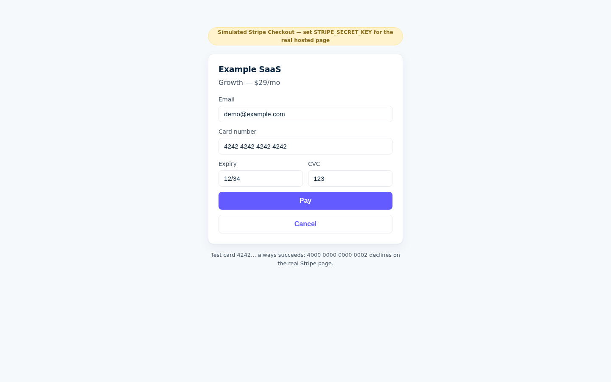

# Stripe checkout demo (test mode)

**Problem:** every SaaS needs a subscription checkout, and the usual mistakes are leaky: unverified webhooks, prices trusted from the client, no cancel path.
**Solution:** the full flow done properly - server-created Checkout Sessions, a signature-verified webhook, success and cancel pages. Ships with a clearly-labelled demo mode so the whole flow runs with zero config.




## Stack

- Next.js 15 (App Router), TypeScript
- Stripe Node SDK: `stripe.checkout.sessions.create` with server-side `price_data`
- `POST /api/webhook` verifies with `stripe.webhooks.constructEvent` before handling `checkout.session.completed` and `customer.subscription.deleted`
- Demo mode: without `STRIPE_SECRET_KEY`, the app renders a local simulation of the Stripe-hosted page

## Run it

```bash
npm install
npm run dev          # http://localhost:3000, demo mode, no keys needed
```

Real test mode:

```bash
cp .env.example .env.local
# fill in STRIPE_SECRET_KEY=sk_test_... and STRIPE_WEBHOOK_SECRET=whsec_...
npm run dev
stripe listen --forward-to localhost:3000/api/webhook   # second shell
```

Test card `4242 4242 4242 4242`, any future expiry, any CVC. `4000 0000 0000 0002` exercises the decline path.

## Flow

1. The pricing page renders plans from a server-side catalogue.
2. `POST /api/checkout` validates the plan and returns the Stripe-hosted Checkout URL (or the local demo page).
3. Stripe redirects to `/success?session_id=...` or `/cancel`.
4. Stripe calls `POST /api/webhook`; the signature is verified before anything is handled.
