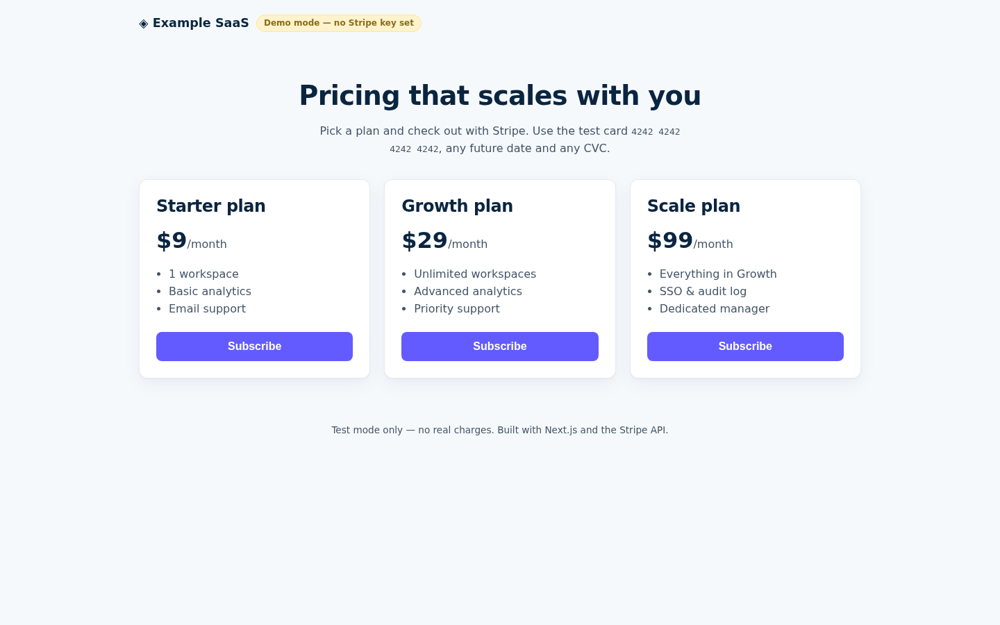

# Stripe Checkout demo (test mode)

**Problem:** Every SaaS needs a subscription checkout, and doing it wrong means leaky payments: unverified webhooks, client-side prices, no cancel path.
**Solution:** A complete, production-shaped flow: server-created Stripe Checkout Sessions, signature-verified webhooks, success/cancel pages - plus a clearly-labelled demo mode that runs with zero configuration.




## Tech

- **Next.js 15 (App Router) + TypeScript**
- **Stripe Node SDK** - `stripe.checkout.sessions.create` with server-side `price_data` (prices never trusted from the client)
- **Webhook endpoint** `POST /api/webhook` with `stripe.webhooks.constructEvent` signature verification, handling `checkout.session.completed` and `customer.subscription.deleted`
- **Demo mode:** with no `STRIPE_SECRET_KEY` set, the app renders a local simulation of the Stripe-hosted page so the whole flow is still reviewable

## Run it

```bash
npm install
npm run dev          # http://localhost:3000 - demo mode, no keys needed
```

Real test mode:

```bash
cp .env.example .env.local
# add STRIPE_SECRET_KEY=sk_test_... and STRIPE_WEBHOOK_SECRET=whsec_...
npm run dev
stripe listen --forward-to localhost:3000/api/webhook   # in another shell
```

Pay with test card `4242 4242 4242 4242`, any future expiry, any CVC. `4000 0000 0000 0002` exercises the decline path.

## Flow

1. Pricing page (`app/page.tsx`) renders plans from a server-side catalogue.
2. `POST /api/checkout` validates the plan and returns a Stripe-hosted Checkout URL (or the local demo page).
3. Stripe redirects to `/success?session_id=...` or `/cancel`.
4. Stripe calls `POST /api/webhook`; the signature is verified before any event is handled.
